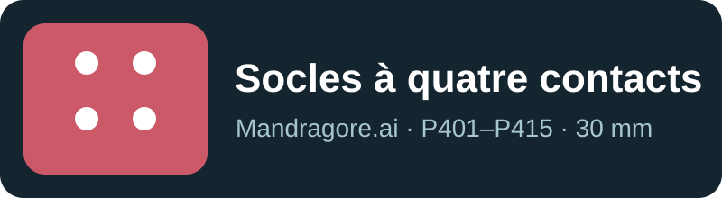

# Socles P401–P415 à quatre contacts

[Mandragore.ai](https://mandragore.ai) · Maitresinh@500nuancesdegeek.fr

Cette recherche est publiée pour que d'autres puissent reproduire les prototypes
et partager leurs mesures. Si vous poursuivez les essais, nous serions heureux
de recevoir vos données, y compris les échecs, avec le modèle exact, l'appareil,
le protocole et les résultats bruts ou agrégés. Contactez-nous avant toute
publication ou exploitation commerciale commune.

**Licence :** [CC BY-NC 4.0](LICENSE.md) pour nos modèles, images, documents et
données. Attribution requise ; usage commercial sur accord séparé.

## Contenu

Quinze géométries de socles d'environ 30 mm, chacune avec quatre contacts
capacitifs. Le plateau Bambu complet et les 15 modèles individuels sont dans
`models/`. Le [plan de lecture](assets/plan-15-4-contacts.svg) et le
[catalogue](docs/catalogue.json) associent chaque silhouette à son code.

## Résultat sur Nexus 5, API Android standard

Une validation indépendante a porté sur 12 codes disponibles, quatre poses
consécutives par code. Une pose erronée déclarée par l'opérateur a été exclue
de l'analyse, sans effacer le fichier original. Parmi 47 essais fiables,
33 ont produit quatre contacts exploitables ; le modèle entraîné a classé
correctement ces 33 captures. **Réussite bout en bout : 33/47 = 70,2 %.** Les
14 autres sont des échecs de capture. Le rejeu temporel donne 38/47, mais
c'est une simulation rétrospective, pas une nouvelle validation physique.

L'écart médian par rapport à une croix de pose manuelle était de 4,34 mm ;
une correction estimée en validation croisée donne 1,88 mm. Ce n'est pas une
mesure de précision absolue. P406, P412 et P413 n'étaient pas disponibles
pour le test. P401 et P411 ont eu peu de captures. Voir le
[bilan détaillé](docs/bilan-validation.md).

## À tester

Retester le vote temporel sur de nouvelles poses, vérifier la tenue en main,
la capture, l'identité et l'orientation séparément, puis répéter sur une
tablette non rootée. « Quatre contacts » décrit la géométrie ; cela ne prouve
pas une détection passive sans main.
